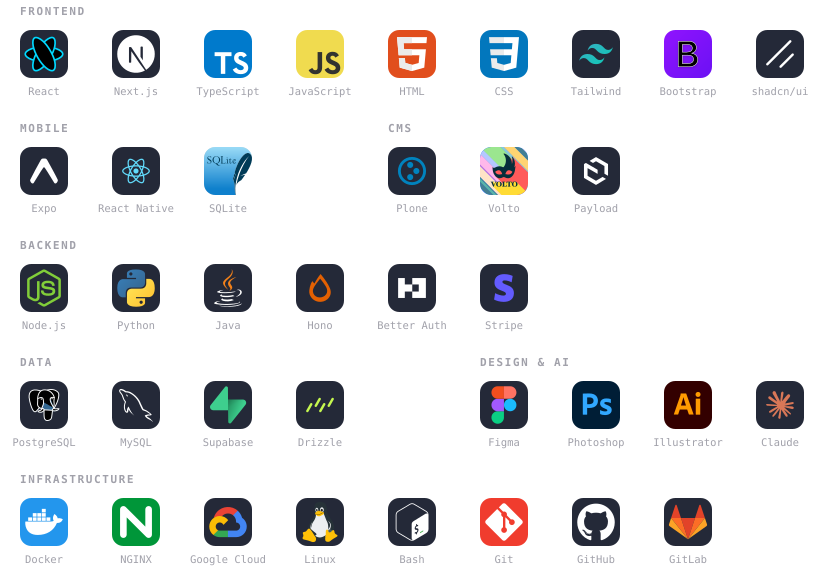

<!--
  Generated assets: run `python3 scripts/build_assets.py` after editing the hero, buttons or the
  tech-stack groups in scripts/build_assets.py. The stats card and the contribution snake are rendered
  daily by .github/workflows/profile-assets.yml into the `output` branch.
-->

<picture>
  <source media="(prefers-color-scheme: dark)" srcset="assets/hero-dark.svg">
  <source media="(prefers-color-scheme: light)" srcset="assets/hero-light.svg">
  
</picture>

 

<a href="https://www.nils-pzr.eu"><picture><source media="(prefers-color-scheme: dark)" srcset="assets/btn-portfolio-dark.svg"><source media="(prefers-color-scheme: light)" srcset="assets/btn-portfolio-light.svg"></picture></a>&nbsp;&nbsp;<a href="https://www.linkedin.com/in/nils-pzr/"><picture><source media="(prefers-color-scheme: dark)" srcset="assets/btn-linkedin-dark.svg"><source media="(prefers-color-scheme: light)" srcset="assets/btn-linkedin-light.svg"></picture></a>&nbsp;&nbsp;<a href="mailto:contact@nils-pzr.eu"><picture><source media="(prefers-color-scheme: dark)" srcset="assets/btn-email-dark.svg"><source media="(prefers-color-scheme: light)" srcset="assets/btn-email-light.svg"></picture></a>&nbsp;&nbsp;<a href="https://socials.nils-pzr.eu"><picture><source media="(prefers-color-scheme: dark)" srcset="assets/btn-socials-dark.svg"><source media="(prefers-color-scheme: light)" srcset="assets/btn-socials-light.svg"></picture></a>

 

## About

I'm Nils, a Full-Stack Developer at **[Interaktiv GmbH](https://www.interaktiv.de)** in Kerpen, Germany. After completing a one-year internship there, I'm now continuing as an apprentice application developer (*Fachinformatiker für Anwendungsentwicklung*).

I build web and mobile applications with **React, Next.js, Expo and TypeScript**. At work that means mostly **Plone, Payload and Python**, including AI-powered features, in a Linux environment with agile Scrum workflows. I come from a design background, so good UI/UX matters to me as much as clean, maintainable code.

<table>
  <tr>
    <td width="160"><b>🛠️&nbsp; Building</b></td>
    <td>Full-stack web apps with Next.js, mobile apps with Expo and React Native, self-hosted tools, and AI features on top of my own data</td>
  </tr>
  <tr>
    <td><b>💼&nbsp; At work</b></td>
    <td>AI assistants for Plone / Volto, Payload-based sites and Next.js products at Interaktiv</td>
  </tr>
  <tr>
    <td><b>📚&nbsp; Learning</b></td>
    <td>Native mobile features with Expo, Python backends, PostgreSQL &amp; Drizzle, and agentic AI development workflows</td>
  </tr>
  <tr>
    <td><b>🤝&nbsp; Open to</b></td>
    <td>Open-source collaboration, side projects and interesting product ideas</td>
  </tr>
</table>

 

## Tech Stack

<picture>
  <source media="(prefers-color-scheme: dark)" srcset="assets/stack-dark.svg">
  <source media="(prefers-color-scheme: light)" srcset="assets/stack-light.svg">
  
</picture>

 

## Featured Projects

<table>
  <tr>
    <td width="50%" valign="top">
      <h3>Gainsmith</h3>
      
Training and nutrition app for bodybuilding. One Expo codebase for iOS, Android and web, local-first with sync to a self-hosted Hono + Postgres backend, Apple Health / Health Connect integration and AI-powered meal logging.

      
<code>Expo</code> <code>React Native</code> <code>TypeScript</code> <code>Hono</code> <code>PostgreSQL</code> <code>Drizzle</code> <code>Better Auth</code> <code>AI</code>

      
In development · private

    </td>
    <td width="50%" valign="top">
      <h3><a href="https://lifeos.nils-pzr.eu/">Life OS</a></h3>
      
Self-hosted life dashboard with an AI coach. Goals, habits, finances, training and health signals in one place, with AI insights on top of your own data.

      
<code>Next.js</code> <code>TypeScript</code> <code>Tailwind CSS</code> <code>PostgreSQL</code> <code>Drizzle</code> <code>AI</code>

      
<a href="https://lifeos.nils-pzr.eu/">Live ↗</a>

    </td>
  </tr>
  <tr>
    <td width="50%" valign="top">
      <h3><a href="https://www.neospend.de/">NeoSpend</a></h3>
      
Personal finance app built around real-time insights, smart budgets and clean analytics. Designed to make money management feel effortless.

      
<code>Next.js</code> <code>React</code> <code>TypeScript</code> <code>Tailwind CSS</code> <code>Supabase</code>

      
<a href="https://www.neospend.de/">Live ↗</a>

    </td>
    <td width="50%" valign="top">
      <h3><a href="https://github.com/nils-pzr/nextjs-starter">nextjs-starter</a></h3>
      
Production-grade Next.js 16 SaaS starter: Better Auth, Stripe billing with webhook reconciliation, Resend email, Drizzle + Postgres, Docker and a nonce-based CSP. Type-safe end to end.

      
<code>Next.js 16</code> <code>Better Auth</code> <code>Stripe</code> <code>Drizzle</code> <code>Resend</code> <code>Docker</code>

      
<a href="https://github.com/nils-pzr/nextjs-starter">Repository ↗</a> &nbsp;·&nbsp; <a href="https://nextjs-starter.nils-pzr.eu">Demo ↗</a>

    </td>
  </tr>
  <tr>
    <td width="50%" valign="top">
      <h3><a href="https://github.com/interaktivgmbh/volto-interaktiv-kyra">KYRA – Volto AI Assistant</a></h3>
      
AI assistant integration for Plone / Volto, built at Interaktiv GmbH. Brings AI-powered editing and translation workflows directly into the CMS.

      
<code>Plone</code> <code>Volto</code> <code>React</code> <code>Python</code> <code>DeepL API</code> <code>AI</code>

      
<a href="https://github.com/interaktivgmbh/volto-interaktiv-kyra">Repository ↗</a>

    </td>
    <td width="50%" valign="top">
      <h3><a href="https://erasmusplus.ai/">erasmusplus.ai</a></h3>
      
AI writing assistant for Erasmus+ grant applications, built at Interaktiv GmbH. Helps organisations draft and refine funding proposals.

      
<code>Next.js</code> <code>React</code> <code>TypeScript</code> <code>Tailwind CSS</code> <code>AI</code>

      
<a href="https://erasmusplus.ai/">Live ↗</a>

    </td>
  </tr>
</table>

<b>More work</b>

 

| Project | What it is | Stack |
|---|---|---|
| [CozyGlow](https://cozyglow.nils-pzr.eu/) | Cozy book tracking app for reading goals, progress and highlights | Next.js, TypeScript, Tailwind CSS, Supabase |
| [Media Downloader](https://media.nils-pzr.eu/) | Self-hosted app to download video and audio from several platforms | Next.js, TypeScript, Tailwind CSS |
| [Rhein-Erft Coding Challenge](https://www.hackathon-rhein-erft.de/) | Website and registration portal for a school hackathon, built at Interaktiv | Next.js, TypeScript, Tailwind CSS |
| [FCMH](https://www.fcmh.de/de) | Public website on Plone / Volto, built at Interaktiv | Plone, Volto, React, Python |
| [ESGLD](https://esgld.org/) | Public website on Plone / Volto, built at Interaktiv | Plone, Volto, React, Python |

 

## Experience

| Period | Role | Where |
|---|---|---|
| Sept 2025 – today | **Full-Stack Developer** · Apprentice Application Developer | [Interaktiv GmbH](https://www.interaktiv.de), Kerpen |
| 2022 – 2025 | **Freelance Frontend Developer & UI/UX Designer** | Remote |
| Sept 2022 | **IT Specialist Intern** | YNCORIS GmbH, Hürth |

Certified <b>Professional Scrum Developer I</b> (Scrum.org)

 

## GitHub

<picture>
  <source media="(prefers-color-scheme: dark)" srcset="https://raw.githubusercontent.com/nils-pzr/nils-pzr/output/stats-dark.svg">
  <source media="(prefers-color-scheme: light)" srcset="https://raw.githubusercontent.com/nils-pzr/nils-pzr/output/stats-light.svg">
  
</picture>

<picture>
  <source media="(prefers-color-scheme: dark)" srcset="https://raw.githubusercontent.com/nils-pzr/nils-pzr/output/github-contribution-grid-snake-dark.svg">
  <source media="(prefers-color-scheme: light)" srcset="https://raw.githubusercontent.com/nils-pzr/nils-pzr/output/github-contribution-grid-snake.svg">
  
</picture>

 

 

Want to build something together? &nbsp;<a href="mailto:contact@nils-pzr.eu">contact@nils-pzr.eu</a>&nbsp; · &nbsp;<a href="https://www.nils-pzr.eu">nils-pzr.eu</a>

